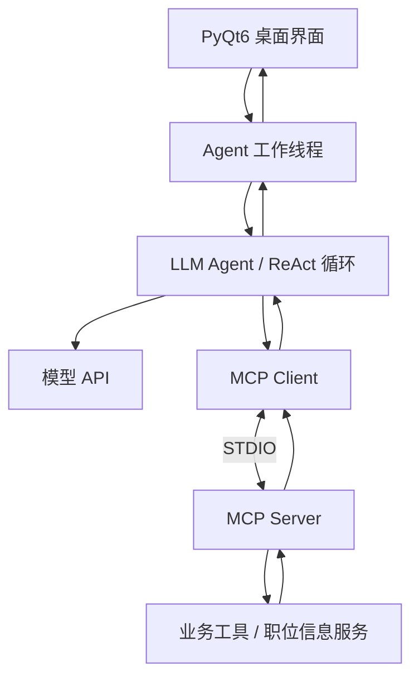

# ReAct MCP Agent

> 基于 **Python + PyQt6 + ReAct + Model Context Protocol (MCP)** 的桌面 AI Agent 应用，支持大语言模型对话、工具发现与调用，以及可视化交互。

## 项目简介

ReAct MCP Agent 是一个面向 **LLM 工具调用与应用集成** 的桌面端实践项目。它将大语言模型与 MCP 工具服务连接起来，使模型能够根据用户请求选择可用工具、执行操作，并结合工具结果继续生成回复。

项目重点在于打通从 **模型配置、对话交互、工具发现、工具调用到执行结果展示** 的完整流程，并通过模块化设计，将界面、Agent 逻辑和 MCP 工具服务解耦，便于扩展新的工具与业务场景。

## 核心功能

- **可视化对话界面**：基于 PyQt6 构建桌面 UI，提供对话与执行反馈。
- **灵活的模型配置**：支持配置模型名称、API Key、接口地址与系统提示词；兼容项目接入的 DeepSeek / OpenAI 风格接口。
- **ReAct 工具调用循环**：根据模型返回的工具调用请求执行操作，并将结果反馈给模型，形成多步交互流程。
- **MCP 工具集成**：通过 MCP 客户端连接本地 STDIO 工具服务，获取工具清单并调用已注册工具。
- **业务工具扩展**：将业务逻辑封装为独立工具服务；当前项目以职位信息相关功能作为工具接入示例。
- **异步任务执行**：将模型请求与工具调用放在工作线程中处理，减少长耗时操作对桌面交互的影响。
- **功能验证**：提供测试代码，用于验证工具注册、模块交互及主要执行流程。

## 技术栈

| 类别 | 使用技术 |
| --- | --- |
| 开发语言 | Python |
| 图形界面 | PyQt6 |
| Agent 模式 | ReAct、LLM Function Calling |
| 工具协议 | Model Context Protocol（MCP），STDIO 通信 |
| 模型接口 | DeepSeek / OpenAI 兼容 API（以项目配置为准） |
| 工程工具 | Git、pytest（测试环境） |

## 系统架构



**主要模块职责：**

- **UI 层**：接收用户输入、展示模型回复和执行状态。
- **Agent 层**：管理提示词与模型请求，判断并处理工具调用，组织多轮执行。
- **MCP 层**：负责工具注册、发现、调用与结果返回，降低模型与业务代码的耦合。
- **业务层**：通过独立服务暴露可复用的业务能力。

## 快速开始

### 1. 获取项目

```bash
git clone https://github.com/wangsiyu187/react-mcp-agent.git
cd react-mcp-agent
```

### 2. 安装依赖

推荐使用虚拟环境：

```bash
python -m venv .venv
```

Windows（PowerShell）：

```powershell
.\.venv\Scripts\Activate.ps1
```

随后安装依赖：

```bash
pip install -r requirements.txt
```

### 3. 配置模型

启动应用后，根据界面或项目提供的配置方式填写：

- **API Key**：对应模型服务的访问密钥。
- **Base URL**：模型服务的 API 地址。
- **Model**：实际使用的模型名称。
- **System Prompt**：用于定义 Agent 的行为与任务边界。

> 配置项及可用模型以当前源码为准。请使用自己的 API Key，并避免将真实密钥写入公开仓库。

### 4. 运行程序

```bash
python main.py
```

通过桌面界面发起对话；当请求匹配已注册的 MCP 工具能力时，Agent 可根据模型输出调用相应工具，并结合返回结果继续回复。

### 5. 运行测试

如已安装测试依赖，可执行：

```bash
python -m pytest -q
```

## 运行流程

1. 用户在 PyQt6 界面输入问题或任务。
2. Agent 向配置的大语言模型发起请求，并提供可用工具描述。
3. 当模型返回工具调用请求时，MCP Client 将请求转发至 MCP Server。
4. MCP Server 执行对应业务工具并返回结果。
5. Agent 将工具结果加入上下文，继续生成最终回复。
6. UI 展示回复或执行反馈。

## 设计要点

- **模块解耦**：模型调用、界面交互、工具协议和业务逻辑分层，方便维护与迭代。
- **工具可扩展**：新增能力时优先封装为 MCP 工具，减少对 Agent 主循环的修改。
- **模型配置灵活**：将模型和接口参数与业务逻辑分离，便于切换支持的服务。
- **可测试性**：将工具调用与主要流程拆分为独立模块，便于进行功能测试和问题定位。

## 项目展示

建议在此处加入实际运行截图或 GIF，包括：

- 主界面及模型配置；
- Agent 触发 MCP 工具调用的过程；
- 工具执行后的回复结果。

> 截图请遮盖 API Key、个人信息及敏感业务数据。

## 注意事项

- 本项目主要用于探索桌面端 AI Agent 与 MCP 工具集成，尚不代表生产环境部署方案。
- 使用前需配置有效的模型服务，相关请求可能产生 API 调用费用。
- 外部工具的执行权限取决于实际注册的 MCP 服务，请在可信环境中运行。
- 不要将 `.env`、真实密钥、个人数据库或其他敏感配置提交至公开仓库。

## 后续方向

- 增加更多独立 MCP 工具与业务场景。
- 完善执行过程展示、错误处理和日志记录。
- 补充测试覆盖率、运行演示与部署说明。
